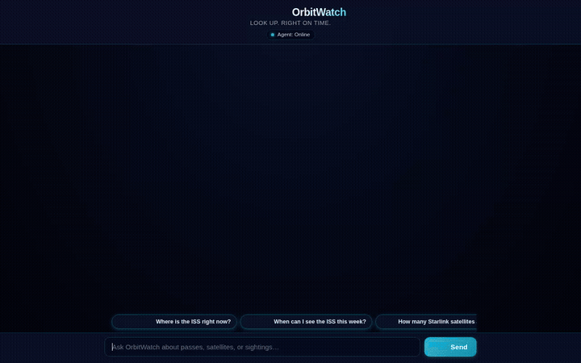

# OrbitWatch 🛰️

> **Look up. Right on time.**  
> An autonomous satellite tracking and astronomical observation agent built with Google Agent Development Kit (ADK), deployed on Vertex AI Agent Engine, and paired with an interactive night-sky web frontend.



---

## 🌌 Overview

**OrbitWatch** turns live orbital data into actionable skywatching forecasts. Rather than static trackers or complex ephemeris tables, OrbitWatch coordinates celestial mechanics, live space weather, and satellite databases into clear visibility alerts and commemorative mission patches.

The agent interacts through standard A2A (Agent-to-Agent) protocol messages, returning both natural language guidance and rich A2UI cards.

---

## 🚀 Implemented Features & Integrations

The capabilities below are fully implemented in [`app/agent.py`](app/agent.py) and verified on Vertex AI:

### 1. Vertex AI Agent Platform & Memory Bank
- **Persistent Long-Term Memory**: Integrates `PreloadMemoryTool` and Vertex AI Memory Bank via custom callbacks (`generate_memories_callback`) to remember observer locations, local coordinates, viewing horizons, optical equipment (naked eye, binoculars, telescope), and favorite satellites across conversations.
- **A2A (Agent-to-Agent) Protocol**: Runs on Agent Runtime with full A2A message formatting and context management.

### 2. Celestial Mechanics & Pass Prediction (Skyfield)
- **High-Precision Pass Prediction (`predict_passes`)**: Calculates exact satellite rise, culmination, and set times, elevation angles, and azimuth compass headings using SGP4 propagation and DE421 planetary ephemeris.
- **Illumination & Optical Visibility**: Computes whether the satellite is sunlit while the observer is in astronomical darkness, identifying visible optical passes.
- **Local Timezone Conversion**: Automatically converts pass timings to observer time (e.g., `Asia/Kolkata`).

### 3. Live External APIs
- **CelesTrak TLE Fetching (`fetch_tle` / `fetch_celestrak_tles`)**: Live Two-Line Element sets by NORAD catalog ID or orbital constellation groups (`stations`, `starlink`, `weather`).
- **Where The ISS At (`get_iss_position` / `get_iss_current_location`)**: Live real-time latitude, longitude, altitude, and velocity for the International Space Station.
- **Open-Meteo Cloud Cover (`get_cloud_cover` / `get_hourly_cloud_cover`)**: Hourly meteorological cloud fraction to evaluate viewing conditions during upcoming passes.
- **Geocoding (`geocode_location`)**: Forward geocoding of city names into coordinates via Open-Meteo.

### 4. Code Execution Sandbox (Vertex AI Agent Engine)
- **Isolated Python Code Sandbox (`run_in_code_sandbox`)**: Runs Python in a secure sandbox (`AgentEngineSandboxCodeExecutor`) for:
  - Computing orbital period, semi-major axis, and mean altitude from TLE mean motion.
  - Counting how many satellites from large constellations (e.g., Starlink) are currently above an observer's horizon.
  - Multi-variable scoring to choose the optimal night for satellite viewing combining pass elevation and forecast cloud cover.

### 5. Google Cloud Firestore
- **Watchlist Management (`list_watchlist`, `add_to_watchlist`)**: Persists tracked satellites and spacecraft in Firestore collection `watchlist`.
- **Sighting Logbook (`log_sighting`, `list_sightings`)**: Records confirmed sightings with timestamps, observation location, optical equipment used, and mission patch URLs in collection `sightings`.

### 6. Imagen 3.1 & Cloud Storage
- **Mission Patch Synthesis (`generate_mission_patch`)**: Generates custom embroidered mission-patch artwork for logged sightings using Vertex AI `gemini-3.1-flash-lite-image`.
- **Cloud Storage Hosting**: Saves patches to Google Cloud Storage (`gs://orbitwatch-badges-fdf4c252`), assigns public URLs, and attaches the patch image to sighting records.

### 7. Rich A2UI & Custom Night-Sky Frontend
- **A2UI v0.8 Basic Catalog**: System prompts dynamically generated via `A2uiSchemaManager` with `a2ui_callback` rendering Cards, Rows, Columns, Texts, and Images.
- **Custom Chat Frontend**: Lightweight, responsive web interface built with FastAPI, HTML5, and CSS:
  - Pure CSS twinkling star field background and night-sky palette.
  - Cyan accents (`#22D3EE`) and gold highlights for visible passes.
  - Live status indicator and one-click quick prompt chips.
  - Embedded A2UI parser for cards and structured tables.

---

## 🛠️ Architecture

```
┌────────────────────────────────────────────────────────┐
│             Web Browser (Mobile / Desktop)             │
└──────────────────────────┬─────────────────────────────┘
                           │ HTTP / JSON
┌──────────────────────────▼─────────────────────────────┐
│     Cloud Run: orbitwatch-frontend (FastAPI Proxy)     │
└──────────────────────────┬─────────────────────────────┘
                           │ A2A Protocol (ADC Auth)
┌──────────────────────────▼─────────────────────────────┐
│    Vertex AI Agent Engine Runtime (Reasoning Engine)    │
│  ┌───────────────────────────────────────────────────┐ │
│  │ Root Agent (Gemini 2.5 Flash + ADK)               │ │
│  └──────┬────────────┬─────────────┬───────────┬─────┘ │
└─────────┼────────────┼─────────────┼───────────┼───────┘
          │            │             │           │
          ▼            ▼             ▼           ▼
    ┌──────────┐ ┌───────────┐ ┌──────────┐ ┌────────────┐
    │ Firestore│ │  GCS /    │ │  Vertex  │ │External APIs│
    │  Catalog │ │  Imagen   │ │  Sandbox │ │ (CelesTrak, │
    │& Sightings│ │ Badges   │ │  Compute │ │Open-Meteo) │
    └──────────┘ └───────────┘ └──────────┘ └────────────┘
```

---

## 💻 Local Setup & Running Instructions

### Prerequisites
- Python 3.11+
- Google Cloud SDK (`gcloud`) authenticated with a project containing Vertex AI, Firestore, and Cloud Storage access.

### 1. Clone & Configure Environment
```bash
git clone <your-repo-url>
cd orbitwatch

# Authenticate with Google Cloud
gcloud auth application-default login
```

### 2. Run the Agent Locally (ADK Web Playground)
```bash
# Install agent dependencies
uv sync

# Launch the ADK playground with Memory Bank integration
uv run adk web . --port 8080 --reload_agents
```

### 3. Run the Custom Frontend
In a separate terminal window:
```bash
cd frontend

# Set configuration variables
export AGENT_ENGINE_RESOURCE_NAME="projects/<PROJECT_ID>/locations/<REGION>/reasoningEngines/<ENGINE_ID>"
export AGENT_DIRECTORY="app"

# Install frontend dependencies
pip install -r requirements.txt

# Start the frontend server
python main.py
```
Open your browser to `http://localhost:8080` (or the configured `PORT`).

---

## 📁 Repository Structure

```
├── agents-cli-manifest.yaml   # Agent Engine deployment manifest
├── deployment_metadata.json   # Deployed Agent Runtime resource metadata
├── demo.gif                   # Looping recording of frontend & agent interactions
├── app/
│   ├── __init__.py            # Root agent export
│   ├── agent.py               # Core agent tools, Skyfield math, memory & Firestore
│   ├── a2ui_utils.py          # A2UI callback and surface serializer
│   ├── a2ui_system_prompt.txt # Precomputed A2UI v0.8 schema prompt
│   └── app_utils/             # Memory service and runtime helpers
└── frontend/
    ├── main.py                # FastAPI proxy communicating over A2A
    ├── Dockerfile             # Container definition for Cloud Run deployment
    ├── requirements.txt       # Frontend dependencies (FastAPI, a2a-sdk, httpx)
    └── static/
        └── index.html         # Single-page night-sky UI with native A2UI renderer
```

---

## 📜 License
Apache 2.0
